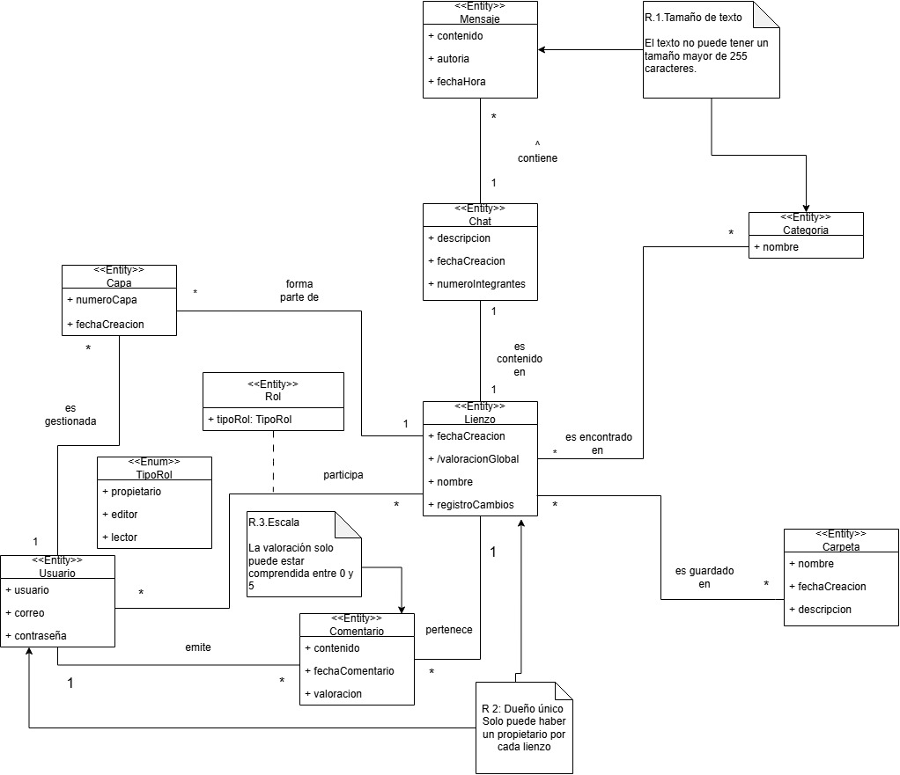
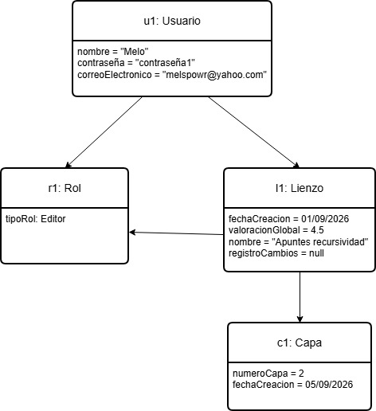
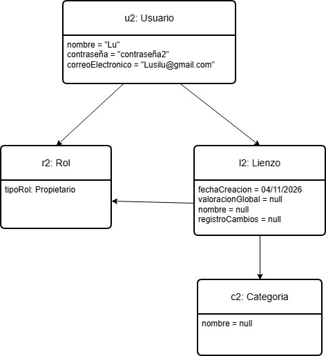
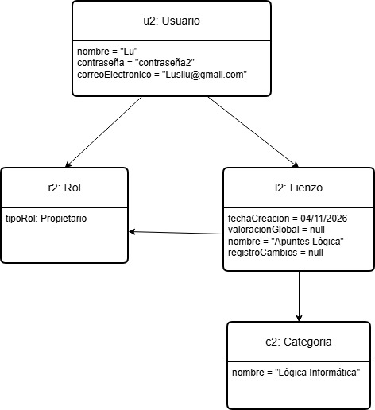
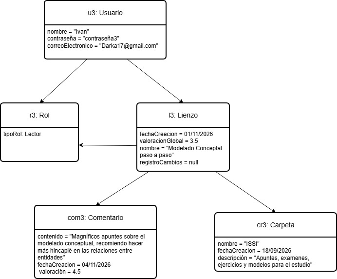

# WILLCHO

## Miembros del grupo L2-ABS-2

1. Alberto Ortega, Iván
1. Andújar Cruz, Juan Carlos
1. Baselga Molina, Álvaro María
1. Casero Calvo, Iván

## 1. Introducción al problema

Ante la privatización de recursos académicos como apuntes y esquemas entre otros documentos y debido a los abusivos precios de suscripciones o anuncios constantes, se busca crear una red de apuntes públicos y gratuitos, con una mejor organización y reducción de anuncios, con el objetivo de crear una gran base de usuarios activos atrayendolos gracias a las mejoras de calidad de vida en comparación a las alternativas y mediante la implementación distintiva de los lienzos, permitiendo dar rienda suelta a la creatividad a la hora de elaborar el material pertinente.

La creación de los lienzos propios contaría con diversas formas de rellenarlos, aceptando una gran cantidad de formatos, desde texto introducido mediante teclado, el trazo con infinidad de opciones (texto, dibujos, esquemas, croquis con diferentes colores, tamaños y pinceles), las imágenes, los hipervínculos...  Siendo capaz de gestionar cada lienzo por capas, cada usuario dentro del lienzo por roles (estos roles estarán organizados en forma de cascada, siendo el orden: propietario del lienzo, editor del lienzo y lector del lienzo, los permisos de cada rol contará los permisos de roles anteriores además de nuevos permisos, siendo estos roles propios de cada usuario en cada lienzo específico), organizarlos mediante el uso de carpetas personales o públicas y etiquetas para que el usuario pueda navegar con facilidad. Además de poder dejar comentarios para dar feedback a los creadores. Para asegurar una mejor experiencia, el usuario será capaz de copiar los lienzos existentes permitiendo esto la realización de cambios sobre ellos y asegurando así de que el material entra en las necesidades del usuario, obligando a mostrar en el lienzo bifurcado cual es su lienzo origen para dar crédito a los creadores originales.

El proyecto está principalmente orientado hacia los estudiantes, sin embargo debido a la libertad de creación que suponen los lienzos buscamos la inclusión de entornos laborales más confidenciales, por lo que se permite la posibilidad de privatizar los lienzos y otorgar un espacio más íntimo. En el entorno académico se recomienda el uso de lienzos para trabajos grupales, con posibilidad de privatizar el lienzo, y colaboraciones a la hora de desarrollar apuntes ya que gracias al sistema de capas permite libertad propia y total a cada uno de los editores del lienzo, e incluso da la posibilidad a otros estudiantes fuera del grupo de trabajo a aportar ideas o correcciones gracias a los comentarios, contando además de las distintas herramientas de trabajo, haciendo a esta aplicación el mejor lugar para trabajar.

## 2. Glosario de términos

- Copyleft: naturaleza de las licencias que dan libertad al usuario. Estas licencias deben de coincidir con la definición de la asociación GNU: [https://www.gnu.org/philosophy/free-sw.html](https://www.gnu.org/philosophy/free-sw.html)

- Servicio: el conjunto que ofrecemos, este incluye pero no se limita a: la página web, la aplicación y la base de datos.

- Objetos: estos contenidos introducidos por los usuarios en un lienzo, esto incluye pero no se limita a: los trazos, imágenes, videos y documentos,

- Lienzo: sección del servicio en el que se añaden los objetos.

- Bifurcación: copia de un lienzo existente por parte de un usuario. Esta copia deberá de respetar las condiciones impuestas por la licencia del creador original.

## 3. Visión general del sistema

### 3.1. Requisitos generales

- Gestión de lienzos: Como usuario de la aplicación quiero poder organizar lienzos en carpetas para un mayor orden, valorarlos, comentarlos, bifurcarse para aportar en futuras búsquedas, facilitar la lectura y edición de estos.

- Control sobre el lienzo: Como propietario de un lienzo, quiero ser el único capaz de gestionar los roles de mis documentos, añadir etiquetas, nombrarlos y privatizarlos, para particularizar mi lienzo.

- Herramientas de entrada: Como editor de un lienzo, quiero tener la opción de escribir tanto mediante trazos, como con teclado además de poder importar imágenes, para adaptarme a mi dispositivo y enriquecer los apuntes.

- Búsqueda de lienzos: Como lector, quiero ser capaz de centrar mi búsqueda en base a las valoraciones, número de comentarios, etiquetas y la fecha de la última modificación de los lienzos, para encontrar el que más me convenga.

### 3.2. Usuarios del sistema
- Usuario registrado:  Personas que tienen acceso a la plataforma para crear sus propias carpetas, buscar lienzos públicos, editar su perfil y hacer forks de apuntes públicos de la comunidad.

- Propietario / Administrador:  Es el creador original de un documento. Tiene el control total sobre ese lienzo, puede cambiar su privacidad (público/privado), eliminarlo, gestionar las categorías y asignar roles a otros usuarios como el de escritor (y el de lector en caso de que sea un lienzo privado).

- Escritor / Editor:  Usuario perteneciente a un lienzo con permisos de modificación. Pueden añadir contenido (texto, trazos, imágenes) trabajando exclusivamente en su propia capa independiente. Además, tiene acceso al chat interno del lienzo para coordinarse con el propietario y otros editores.

- Lector: Usuario que accede a un lienzo (público o mediante invitación) en modo de solo lectura. No puede cambiar el contenido del apunte ni participar en el chat de escritores, pero puede interactuar dejando comentarios y valorando el documento.

## 4. Catálogo de requisitos

### 4.1. Requisitos funcionales

##### R.F.01. Consultar información de chats
Como participante de un chat quiero consultar en los chats los participantes de este y el historial de mensajes con sus respectivas fechas y horas.

**Prueba de aceptación**

- El participante accede al chat y es capaz de visualizar los distintos mensajes con sus respectivas fechas, horas y emisores.
- El usuario intenta acceder al chat y es incapaz debido a que no es participante de este.

##### R.F.02. Administrar lienzos
Como propietario de un lienzo quiero poder consultar las carpetas donde están guardadas, las diferentes categorías atribuidas a mi lienzo y el lista de usuarios que accede a mi lienzo junto con sus roles.
	
**Prueba de aceptación**

- El propietario del lienzo accede al lienzo y este le muestra de forma separada las categorías asignadas al lienzo, y los usuarios del mismo. Una vez selecciona un usuario este es capaz de ver el nombre de la carpeta donde dicho usuario tiene guardado el lienzo.
- El propietario no es capaz de ver la lista de usuarios que han accedido al lienzo debido a errores en el sistema.
- El propietario no es capaz de ver la carpeta donde un usuario concreto guarada el lienzo debido a errores en el sistema.

##### R.F.03. Consultar datos personales
Como usuario quiero poder consultar mis datos personales cuando lo necesite.

**Prueba de aceptación**

- El usuario accede sin problema a la sección de consulta de sus datos.
- El usuario es incapaz de acceder a sus datos personales debido a que no los ha rellenado.

##### R.F.04. Consultar rango en el lienzo
Como usuario quiero poder consultar quien es el propietario del lienzo y que rol tengo.

**Prueba de aceptación**

- El usuario accede a un lienzo y consulta el propietario y su propio rol dentro de este.
- El usuario intenta acceder a un lienzo y es incapaz debido a que es un lienzo privado y no tiene el rol de editor dentro de ese lienzo.
- Se debe aplicar la regla de negocio R.N.01.
- Se debe aplicar la regla de negocio R.N.02.

##### R.F.05. Consultar información del lienzo
Como usuario me gustaría poder ver la descripción del lienzo y la categoría para comprender mejor el tema que abarca.

**Prueba de aceptación**

- EL usuario busca un lienzo y antes de acceder a el, le aparecen las categorías relacionadas a este y una breve descripción de este.
- El usuario es incapaz de ver la categoría o la descripción que el propietario intento poner debido a que era muy larga o con caracteres desconocidos.

##### R.F.06.  Comparar comentarios
Como lector de lienzos quiero poder ver mis comentarios y los de otros usuarios y ordenarlos por fecha.

**Prueba de aceptación**

- El usuario accede al lienzo y dentro de este es capaz de visualizar todos los comentarios.
- Una vez el usuario es capaz de visualizar los comentarios este los ordena por fecha ascente. 
- El usuario es incapaz de acceder a los comentarios ya que no se ha publicado ninguno hasta el momento.

##### R.F.07. Consultar relación comentarios-lienzo
Como propietario de un lienzo, quiero ver sus categorías junto a sus comentarios para moderar su contenido.

**Prueba de aceptación**

- El propietario accede al conjunto de categorías de su lienzo para ser capaz de añadir o eliminar categorías.
- El propietario es capaz de acceder a los comentarios de su lienzo.
- El usuario es incapaz de cambiar las categorías del lienzo ya que no es el propietario del mismo.

##### R.F.08. Administrar el chat
Como propietario del lienzo, quiero ver la clase de usuario del que haya escrito un mensaje.

**Prueba de aceptación**

- El propietario accede a los comentarios y le aparecen los distintos comentarios, el usuario y su rol dentro del lienzo.
- El propietario es incapaz de acceder a los comentarios debido a la ausencia de estos.

##### R.F.09. Gestionar carpetas personales
Como usuario quiero ver cuántas carpetas tengo y cuál fue la primera de todas ellas.

**Prueba de aceptación**

- El usuario accede a su espacio personal donde organiza los distintos lienzos en carpetas y subcarpetas.
- El usuario es incapaz de acceder a sus carpetas ya que no cuenta con ninguna y no ha guardado ningún lienzo en su espacio personal.

##### R.F.10. Valorar los lienzos temporalmente
Como usuario, quiero ver las fechas de los comentarios de un mismo usuario y ver un histórico de sus valoraciones en distintos lienzos.

**Prueba de aceptación**

- El usuario accede a la información especifica de otro usuario y es capaz de ver el historial de sus comentarios y valoraciones en lienzos publicos.
- El usuarios es incapaz de acceder a la información de otro usuario ya que este no ha publicado ningún comentario.

#### 4.1.1. Requisitos de información

##### R.I.01. Lienzo
Como desarrollador de la aplicación necesito tener la siguiente información sobre los lienzos para una mayor organización:
- Fecha de creación.
- Registro de cambios.
- Valoración global//Compuesto.
- Nombre.

**Prueba de aceptación**
- Se deja una categoría en blanco y falla.
- El propietario da permisos de administrador a otra persona y da error.
- Se realiza una modificación y se almacena automáticamente en el registro de cambios.

##### R.I.02. Mensaje 
Como usuario quiero tener la siguiente información sobre los mensajes para mantener el control sobre los chats:
- Contenido.
- Autoría.
- Fecha y hora del envío.

**Prueba de aceptación**
- Se escribe un contenido con una cantidad de caracteres mayor del tamaño permitido y da error.
- Escribo un contenido en el mensaje con un tamaño dentro del límite y se envía correctamente.

##### R.I.03. Usuario
Como desarrollador quiero escribir la siguiente información sobre los usuarios para poder mantenerlos todos identificados:
- Nombre del usuario.
- Correo del usuario.
- Contraseña.

**Prueba de aceptación**
- Se intenta crear una cuenta con un correo ya registrado y da error.
- Se inicia sesión con un correo y una contraseña correcta y accedes a tu cuenta.
- Se debe escribir la contraseña correctamente o no iniciará sesión.
  
##### R.I.04. Carpeta
Como desarrollador quiero poder acceder a la siguiente información sobre mis carpetas para tener mis archivos más ordenados:
- Nombre de la carpeta.
- Fecha de creación.
- Descripción.

**Prueba de aceptación**
- Se intenta crear una carpeta sin lienzos y da error.
- Se crea una nueva carpeta correctamente al añadir un lienzo y asignarle un nombre.

##### R.I.05. Comentario
Como desarrollador quiero incluir la siguiente información sobre los comentarios para saber la opinión de las personas:
- Contenido.
- Fecha de los comentarios.
- Valoración.

**Prueba de aceptación**
- Un comentario debe mantenerse aunque el emisor se haya borrado.
- Intento mandar un mensaje y falla si no contiene nada.
- Mando un mensaje a una hora y el receptor lo recibe al momento.

##### R.I.06. Rol
Como desarrollador quiero saber lo siguiente sobre los roles para administrar lo que pueda hacer cada usuario:
- Tipo del rol (Escritor,lector).

**Prueba de aceptación**
- Se añade un usuario al lienzo con un tipo de rol y se le asignan automáticamente los permisos.
- No se le pueden asignar exactamente los mismos permisos a dos roles distintos.

##### R.I.07. Chat
Como desarrollador quiero acceder a la siguiente información sobre los chats para ser consciente de cómo está compuesto el chat:
- Descripción.
- Número integrantes.
- Fecha de creación.

**Prueba de aceptación**
- El chat se crea nada más se crea el lienzo.
- Se intenta modificar el chat sin ser el propietario y da error.

##### R.I.08. Categoría
Como desarrollador quiero saber la siguiente información sobre la categoría para saber cómo catalogar mi lienzo:
- Nombre.

**Prueba de aceptación**
- La categoría se deja en blanco y da error ya que el tamaño es cero.
- En el nombre se introducen caracteres que no son aceptados y los sustituye con una interrogación.

##### R.I.09. Capa
Como desarrollador quiero saber las siguientes propiedades de las capas para saber quién está aportando al lienzo:
- Número de capa.
- Fecha y hora de creación.
		
**Prueba de aceptación**
- Me da error al intentar eliminar la capa base.
- Las capas se van creando de forma ordenada y posterior a la creación de la anterior.

#### 4.1.2. Reglas de negocio

##### R.N.01. Control de escritura sobre el lienzo

El sistema debe validar que la acción de escritura esté bloqueada para todos aquellos usuarios que no cuenten con el rol de escritor en ese lienzo.

**Prueba de aceptación**

- Melo, que tiene el rol de escritor en el lienzo "Apuntes recursividad", añade un trazo en su capa y el sistema permite la operación, guardándola en el registro de cambios.

- Ivan, que tiene el rol de lector en el lienzo "Modelado Conceptual paso a paso", intenta añadir texto en el lienzo y el sistema bloquea la escritura mostrando un error, sin modificar el lienzo.

##### R.N.02. Categorización obligatoria de los lienzos públicos

Para garantizar que la plataforma de apuntes mantenga un orden óptimo en las búsquedas, todo lienzo público debe estar vinculado obligatoriamente a al menos una categoría. El sistema impedirá publicar un lienzo si no se le ha asignado una categoría válida.

**Prueba de aceptación**

- Lu asigna la categoría "Programación" a su lienzo y lo publica como público, el sistema valida que tiene al menos una categoría válida y permite la publicación.

- Lu intenta publicar como público un lienzo sin ninguna categoría asignada y el sistema impide la publicación mostrando un error, quedando el lienzo como privado.

##### R.N.03. Control sobre las autovaloraciones

El sistema no permitirá que el usuario creador (Propietario/Administrador) de un lienzo publique comentarios con valoración en su propio documento. Esto se hace para evitar que el autor infle artificialmente la nota de sus apuntes.

**Prueba de aceptación**

- Ivan, que no es el propietario del lienzo "Modelado Conceptual paso a paso", publica un comentario con valoración 4.5 y el sistema lo guarda y recalcula la valoración global del lienzo.

- Lu, que es la propietaria de su lienzo, intenta publicar en él un comentario con valoración 5 y el sistema lo rechaza mostrando un error, sin guardar el comentario ni modificar la valoración global.

##### R.N.04. Eliminación de lienzos:

Por la sanidad del servicio. La eliminación de una cuenta no implica la eliminación inmediata de sus creaciones ni contribuciones. En caso de querer eliminar una capa o lienzo, estos tendrán un temporizador de siete días hasta ser definitivamente eliminados, pudiendo ser bifurcados en ese proceso por otro usuario.

**Prueba de aceptacion**

- Tratar de eliminar un lienzo que ya está en este proceso semanal da error, y esta acción no debe haber realizado cambios en el temporizador.

- La interacción de eliminar una capa, pone a la misma en un purgatorio de 7 días antes de ser eliminada.

##### R.N.05. Licencias:

La plataforma tendrá un rango limitado de licencias permitidas. Todas ellas copyleft, asegurando la posibilidad de clonar un proyecto y contribuir.

- La colocación de una licencia desconocida debe de dar error, y dar la opción de enviar dicha licencia a los administradores del servicio.

- La licencia está registrada en la base de datos como permitida y el lienzo se publica.

### 4.2. Mapa de historias de usuario (opcional)

### 4.3. Requisitos no funcionales (opcional)

**R.N.F. 01. Título requisito no funcional**
Como [tipo de usuario]
quiero [servicio]
para [razón]

-- fin entregable 1 --

## 5. Modelo conceptual

### 5.1. Diagramas de clases UML

### 5.2. Escenarios de prueba
Para comprobar el modelo, se presentan los siguientes escenarios con sus respectivos diagramas de objetos

##### ESCENARIO DE PRUEBA EP-01: Editor modifica el lienzo
**Objetivo** Comprobar que un usuario (editor) puede acceder y realizar cambios dentro de un lienzo donde es editor

**Descripción textual:** El usuario Melo accede al lienzo que quiere editar. Posteriormente accede a este lienzo donde su rol es de editor y realiza un cambio en su respectiva capa. El sistema valida que Melo es editor dentro del lienzo, además de validar que dentro del mismo lienzo es propietario de la capa a editar y se permite la operación.

**Objetos involucrados:**
- u1: Usuario (nombre="Melo", contraseña="contraseña1", correoElectronico="melspowr@yahoo.com")
- l1: Lienzo (fechaCreacion: 01/09/2026, valoracionGlobal: 4.5, nombre: "Apuntes recursividad", registroCambios: null)
- r1: Rol (tipoRol: Editor) vinculado a Lienzo y a Usuario
- c1: Capa (numeroCapa=2, fechaCreacion=05/09/2026)

##### ESCENARIO DE PRUEBA EP-02: Propietario categoriza el lienzo
**Objetivo:** Comprobar que el propietario es capaz de asignar categorías y cambiar el nombre del lienzo, verificando que el sistema lo permite al ser propietario del lienzo

**Descripción textual:** El usuario Lu crea un lienzo. A continuación el sistema obliga al usuario a darle un nombre y a asignarle al menos 1 categoría al lienzo. El sistema valida que Lu es el propietario del lienzo y que el nombre y la categoría están permitidas y se permite la operación

**Objetos involucrados:** 
- u2: Usuario (nombre="Lu", contraseña="contraseña2", correoElectronico="Lusilu@gmail.com")
- l2: Lienzo (fechaCreacion: 04/11/26, valoracionGlobal: null, nombre: null, registroCambios: null)
- r2: Rol (tipoRol: Propietario) asociado a Lienzo y a Usuario
- c2: Categoria (nombre: null)

Imagen de las relaciones previas al cambio

Imagen de las relaciones post cambio

##### ESCENARIO DE PRUEBA EP-03: Lector organiza y valora
Objetivo: Comprobar que un usuario (lector) puede comentar y guardar lienzos en carpetas siendo necesario que el sistema verifique si el lienzo no es propio

**Descripción textual:** El usuario Ivan accede como lector a un lienzo y procede a dejar un comentario sobre el mismo. El sistema valida que Ivan no es el propietario del lienzo ni un editor y que el comentario y valoración están permitidas y se permite la operación

**Objetos involucrados:**
- u3: Usuario (nombre="Ivan", contraseña="contraseña3", correoElectronico="Darka17@gmail.com")
- l3: Lienzo (fechaCreacion:  01/11/26, valoracionGlobal: 3.5, nombre: "Modelado Conceptual paso a paso", registroCambios: null)
- r3: Rol (tipoRol: Lector) asociado a Lienzo y a Usuario
- cr3: Carpeta (nombre = "ISSI", fechaCreacion = 18/09/2026,descripción = "Apuntes, exámenes, ejercicios y modelos para el estudio")
- cm3: Comentario (contenido="Magníficos apuntes sobre el modelado conceptual, recomiendo hacer más hincapié en las relaciones entre entidades",fechaCreacion = 04/11/2026, valoración = 4.5 )

## 6. Matrices de trazabilidad

- Matriz de trazabilidad entre los requisitos de información y los elementos del modelo conceptual:

|        | Lienzo | Mensaje | Usuario | Carpeta | Comentario | Rol | Chat | Categoría | Capa | R.1.Tamaño del texto | R.2.Dueño único |
|:-------|:-------|:--------|:--------|:--------|:-----------|:----|:-----|:----------|:-----|:---------------------|:----------------|
| RI-1   | X      |         | X       | X       | X          | X   | X    | X         | X    |                      | X               |
| RI-2   |        | X       |         |         |            |     | X    |           |      | X                    |                 |
| RI-3   | X      |         | X       |         | X          | X   |      |           | X    |                      |                 |
| RI-4   | X      |         |         | X       |            |     |      |           |      |                      |                 |
| RI-5   | X      |         | X       |         | X          |     |      |           |      |                      |                 |
| RI-6   | X      |         | X       |         |            | X   |      |           |      |                      |                 |
| RI-7   | X      | X       |         |         |            |     | X    |           |      |                      |                 |
| RI-8	 | X  	  |		    |	      |		    |            |     |      | X         |      | X                    |                 |
| RI-9   | X  	  |	        | X       |		    |            |     |      |           | X    |                      |                 |

Continuación de la tabla anterior:

|        | Es gestionada | Forma parte de | Participa | Emite | Pertenece | Es guardado en | Es encontrado en | Es contenido | Contiene |
|:-------|:--------------|:---------------|:----------|:------|:----------|:---------------|:-----------------|:-------------|:---------|
| RI-1   |               | X              | X         |       | X         | X              | X                | X            |          |
| RI-2   |               |                |           |       |           |                |                  |              | X        |
| RI-3   | X             |                | X         | X     |           |                |                  |              |          |
| RI-4   |               |                |           |       |           | X              |                  |              |          |
| RI-5   |               |                |           | X     | X         |                |                  |              |          |
| RI-6   |               |                | X         |       |           |                |                  |              |          |
| RI-7   |               |                |           |       |           |                |                  | X            | X        |
| RI-8	 |               |                |           |       |           |                | X                |              |          |
| RI-9   | X             | X              |           |       |           |                |                  |              |          |

- Matriz de trazabilidad entre las reglas de negocio y los elementos del modelo conceptual:

|        | Lienzo | Mensaje | Usuario | Carpeta | Comentario | Rol | Chat | Categoría | Capa | R.1.Tamaño del texto | R.2.Dueño único |
|:-------|:-------|:--------|:--------|:--------|:-----------|:----|:-----|:----------|:-----|:---------------------|:----------------|
| RN-1   | X      |         | X       |         |            | X   |      |           | X    |                      |                 |
| RN-2   | X      |         |         |         |            |     |      | X         |      |                      |                 |
| RN-3   | X      |         | X       |         | X          | X   |      |           |      |                      | X               |
| RN-4   | X      |         | X       |         |            |     |      |           | X    |                      |                 |
| RN-5   | X      |         |         |         |            |     |      |           |      |                      |                 |

Continuación de la tabla anterior:

|        | Es gestionada | Forma parte de | Participa | Emite | Pertenece | Es guardado en | Es encontrado en | Es contenido | Contiene |
|:-------|:--------------|:---------------|:----------|:------|:----------|:---------------|:-----------------|:-------------|:---------|
| RN-1   | X             | X              | X         |       |           |                |                  |              |          |
| RN-2   |               |                |           |       |           |                | X                |              |          |
| RN-3   |               |                | X         | X     | X         |                |                  |              |          |
| RN-4   | X             | X              |           |       |           |                |                  |              |          |
| RN-5   |               |                |           |       |           |                |                  |              |          |

- Matriz de trazabilidad entre los requisitos funcionales y los elementos del modelo conceptual:

|	| Lienzo | Mensaje | Usuario | Carpeta | Comentario | Rol | Chat | Categoría | Capa | R.1.Tamaño del texto | R.2.Dueño único |
|:------|:------ |:--------|:--------|:--------|:-----------|:----|:-----|:----------|:-----|:---------------------|:----------------|
| RF-1	|	 | X       | X       | 	       |            |     | X    |           |      | X                    |                 |
| RF-2	| X      |         | X       | X       |            | X   |      | X         | X    |                      |                 |
| RF-3	|        |         | X       |         |            |     |      |           |      |                      |                 |
| RF-4	| X      |         | X       |         |            | X   |      |           |      |                      | X               |
| RF-5	| X      |         |         |         |            |     |      | X         |      |                      |                 |
| RF-6	| X      |         | X       |         | X          |     |      |           |      |                      |                 |
| RF-7	| X      |         |         |         | X          |     |      | X         |      |                      |                 |
| RF-8	|        |         | X       |         |            | X   | X    |           |      |                      |                 |
| RF-9	|        |         |         | X       |            |     |      |           |      |                      |                 |
| RF-10	|        | X       | X       |         |            |     |      |           |      |                      |                 |

|        | Es gestionada | Forma parte de | Participa | Emite | Pertenece | Es guardado en | Es encontrado en | Es contenido | Contiene |
|:-------|:--------------|:---------------|:----------|:------|:----------|:---------------|:-----------------|:-------------|:---------|
| RF-1   |               | X              | X         |       |           |                |                  |              |          |
| RF-2   | X             |                | X         |       |           |                |                  |              |          |
| RF-3   |               |                |           | X     |           |                |                  |              |          |
| RF-4   | X             |                |           |       |           |                |                  |              |          |
| RF-5   | X             |                | X         |       |           |                |                  |              |          |
| RF-6   |               | X              |           |       |           |                |                  | X            |          |
| RF-7   |               |                |           |       |           |                |                  |              |          |
| RF-8   | X             | X              |           |       | X         |                |                  |              |          |
| RF-9   |               |                |           |       |           |                |                  |              |          |
| RF-10  |               |                | X         |       |           |                |                  |              |          |

-- fin entregable 2 --

## 7. Modelo relacional en 3FN

- Relaciones obtenidas al aplicar la transformación del modelo conceptual.

### 7.1.  Justificación de la estrategia de transformación de jerarquías

- si se identificaron jerarquías en el MC.

### 8. Matriz de trazabilidad MC/SQL (opcional):

- Restricciones sobre el MC / Elementos del modelo tecnológico (SQL) (Triggers, checks, etc.)
- Incluir Reglas de negocio — Constraints/Triggers en las matrices de trazabilidad para el entregable 3

|       | EntidadX   | AsociaciónX  | RestricciónX  | Entidad2 ...   | 
|:-------|:-------|:-------|:-------|:-------|
| TABLA-1 |        |        |        |        |
| TABLA-2 |        |        |        |        |
| TABLA-3 |        |        |        |        |
| TABLA-4 |        |        |        |        |
| TRIG-1 |        |        |        |        |
| TRIG-2 | X      | X      |        | X      |
| TRIG-3 |        | X      |        | X      |
| TRIG-4 |        |        | X      |        |
| CONST-1 |        |        |        |        |
| CONST-2 | X      | X      |        | X      |
| CONST-3 |        | X      |        | X      |
| CONST-4 |        |        | X      |        |

Se consideran todo tipo de constraints declarativas (aquellas definidas durante el CREATE TABLE).
-- fin entregable 3 --

## Referencias

